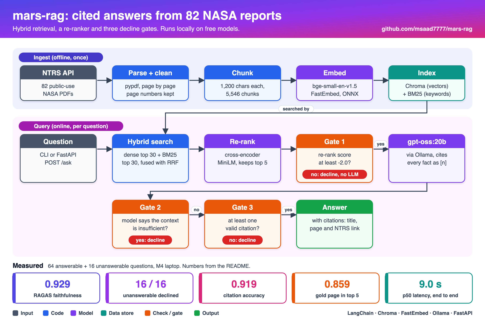
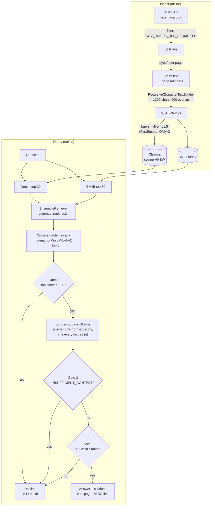

# Mars mission research assistant

A retrieval-augmented generation (RAG) system that answers questions about human Mars missions from **82 NASA technical reports**. Every answer cites the report and page it came from. When the reports don't contain the answer, it **declines** instead of guessing.

Everything runs locally on free, open models: no API keys, no paid services.

```text
$ mars-rag ask "Why does the Mars Ascent Vehicle use methane and oxygen?"
The Mars Ascent Vehicle uses methane and oxygen because this cryogenic propellant pair is considered
the most promising for on-Mars production, offering volumetric favorability over liquid hydrogen and
enabling a "Mars-forward" architecture [3]. Additionally, an ISRU system that produces both methane
and oxygen from Martian resources can reduce the landed propellant mass by up to 95 % ... [5].
  [3] A Parametric Assessment of Lunar and Mars Ascent Vehicle Synergy, p.9   https://ntrs.nasa.gov/citations/20205007701
  [5] An ISRU Propellant Production System to Fully Fuel a Mars Ascent Vehicle, p.10   https://ntrs.nasa.gov/citations/20170001421

$ mars-rag ask "When did astronauts last walk on the Moon?"
The NASA reports in this corpus do not cover that question.
  (declined: retrieval_gate (top rerank score -3.57))
```

## Results at a glance

Measured on 64 answerable and 16 unanswerable questions. The method and its caveats are under [Evaluation](#evaluation).

| Metric | Result |
|---|---|
| RAGAS faithfulness | **0.929** |
| RAGAS context precision (with reference) | **0.839** |
| RAGAS context recall | **0.933** |
| Citation accuracy (cited passage supports the sentence) | **0.919** (74 citations checked) |
| Unanswerable questions correctly declined | **16 / 16** |
| Answerable questions wrongly declined | **4 / 64** (6.2 %) |
| Retrieval: gold page in top 5 / MRR@5 (hybrid + re-rank) | 0.859 / 0.786 |
| End-to-end latency p50 / p95 (all 80 queries, M4 laptop) | 9.0 s / 19.5 s |

## Architecture



<details>
<summary>Same diagram as text (Mermaid)</summary>



</details>

The pipeline is built on **LangChain**:
- `langchain-chroma` for the vector store.
- `langchain-text-splitters` for chunking.
- The `EnsembleRetriever` from `langchain-classic` for rank fusion.
- `ChatOllama` for generation.

The embedding model, BM25 retriever and re-ranker are small adapters written against `langchain-core` interfaces ([`components.py`](src/mars_rag/components.py)), because `langchain-community` is being sunset.

The same pipeline is available as a CLI (`mars-rag ask`) and as a FastAPI service (`POST /ask`, bound to `127.0.0.1`).

## Design decisions

- **Hybrid retrieval.** Dense vectors capture meaning ("protecting the crew from radiation"). BM25 catches exact technical terms such as acronyms (MAV, ISRU, NEP), propellant names and part numbers, which small embedding models blur. Reciprocal rank fusion merges the two without having to calibrate their scores against each other.
- **Re-ranking with a cross-encoder.** It reads the question and the passage together, so it orders the top results much better: MRR@5 rose from 0.704 to 0.786. It also gives a score that can be read as an absolute relevance value, which is what makes the first decline gate possible.
- **Three decline gates, cheapest first.**
  1. **Retrieval gate:** a low re-rank score declines with no LLM call. Off-topic questions are refused in about 1 second and cost nothing.
  2. **The model's own judgement:** it must reply `INSUFFICIENT_CONTEXT` when the excerpts don't hold the answer.
  3. **Citation check:** an answer with no valid `[n]` citation is treated as ungrounded and declined. Citations pointing to excerpts that don't exist are stripped.
- **Citations at page level.** Each chunk keeps its source page, so a citation links to the NTRS record plus the page number, not just the document.
- **Local, free models.** gpt-oss:20b runs through Ollama, and the embeddings and re-ranker run on CPU through ONNX (FastEmbed), with no PyTorch. The whole stack fits on a 24 GB laptop.
- **Licence filter at download time.** Only NTRS records with the copyright determination `GOV_PUBLIC_USE_PERMITTED` (US Government works cleared for public use) are downloaded. Presentations, abstracts and posters are skipped because they carry little extractable text.

## Data: NASA reports used

- **Source:** the [NASA Technical Reports Server (NTRS)](https://ntrs.nasa.gov) public API.
- **Selection:** 12 topic queries (human Mars mission architecture; entry, descent and landing; ISRU propellant; surface habitats; crew radiation; ascent vehicles; aerocapture; sample return; nuclear propulsion; closed-loop life support; dust; landing site selection). Up to 7 eligible reports were taken per query.
- **Coverage:** 82 reports published between 1975 and 2025, from JSC, MSFC, LaRC, ARC, NASA HQ and others. They include conference papers, technical memoranda, contractor reports and NASA special publications.
- **Licence:**
  - Every report is a US Government work that NTRS marks `GOV_PUBLIC_USE_PERMITTED`.
  - The PDFs are **not** committed. `mars-rag download` fetches them again from NTRS.
  - [`data/manifest.json`](data/manifest.json) records each report's ID, title, publication year, NASA centre, type, licence field and URL.
  - The code is released under the MIT licence.

<details>
<summary><b>All 82 reports (click to expand)</b></summary>

| NTRS ID | Title | Year | Centre | Type |
|---|---|---|---|---|
| [19990008862](https://ntrs.nasa.gov/citations/19990008862) | An Overview of Mars Vicinity Transportation Concepts for a Human Mars Mission | 1998 | MSFC | Reprint |
| [20240013888](https://ntrs.nasa.gov/citations/20240013888) | Nuclear Thermal Propulsion Requirements Analysis of the ESAS Reference Human Mars Mission Architecture | 2006 | HQ | Other |
| [20100028285](https://ntrs.nasa.gov/citations/20100028285) | Human Exploration of Mars Design Reference Architecture 5.0 | 2010 | JSC | Preprint |
| [20160010261](https://ntrs.nasa.gov/citations/20160010261) | Mission Design Considerations for Mars Cargo of the Human Spaceflight Architecture Team's Evolvable Mars Campaign | 2016 | GRC | Conference Paper |
| [20160011571](https://ntrs.nasa.gov/citations/20160011571) | Human Mars Entry, Descent, and Landing Architecture Study Overview | 2016 | LaRC | Conference Paper |
| [20230016121](https://ntrs.nasa.gov/citations/20230016121) | Round-Trip Mars Mission Mass Challenges | 2024 | HQ | White Paper |
| [20240015571](https://ntrs.nasa.gov/citations/20240015571) | Exploration Systems Development Mission Directorate: Moon to Mars Architecture Definition Document  | 2025 | HQ | Technical Publication |
| [19870008298](https://ntrs.nasa.gov/citations/19870008298) | Manned Mars mission vehicle design requirements for aerocapture | 1986 | JSC | Conference Paper |
| [19910011855](https://ntrs.nasa.gov/citations/19910011855) | Parametric entry corridors for lunar/Mars aerocapture missions | 1991 | CDMS | Technical Memorandum |
| [20040085958](https://ntrs.nasa.gov/citations/20040085958) | Atmospheric Models for Aerocapture | 2004 | MSFC | Preprint |
| [20050207380](https://ntrs.nasa.gov/citations/20050207380) | A Comparative Study of Aerocapture Missions with a Mars Destination | 2005 | MSFC | Preprint |
| [20050207555](https://ntrs.nasa.gov/citations/20050207555) | Atmospheric Models for Mars Aerocapture | 2005 | MSFC | Preprint |
| [20060005595](https://ntrs.nasa.gov/citations/20060005595) | Mars Aerocapture and Validation of Mars-GRAM with TES Data | 2005 | MSFC | Preprint |
| [20090014745](https://ntrs.nasa.gov/citations/20090014745) | Aerocapture Technologies | 2006 | MSFC | Conference Paper |
| [20160006401](https://ntrs.nasa.gov/citations/20160006401) | Mars Ascent Vehicle Design for Human Exploration | 2015 | MSFC | Conference Paper |
| [20160012111](https://ntrs.nasa.gov/citations/20160012111) | Human Mars Ascent Vehicle Performance Sensitivities | 2016 | MSFC | Conference Paper |
| [20200002328](https://ntrs.nasa.gov/citations/20200002328) | Mars Ascent Vehicle Solid Propulsion Configuration | 2020 | MSFC | Conference Paper |
| [20205007255](https://ntrs.nasa.gov/citations/20205007255) | Recommended Crew Systems Capabilities for a Mars Ascent Vehicle as a Function of Flight Duration | 2020 | JSC | Conference Paper |
| [20205007701](https://ntrs.nasa.gov/citations/20205007701) | A Parametric Assessment of Lunar and Mars Ascent Vehicle Synergy | 2020 | LaRC | Conference Paper |
| [20210026439](https://ntrs.nasa.gov/citations/20210026439) | Updated Human Mars Ascent Vehicle Concept in Support of NASA's Strategic Analysis Cycle 2021 | 2022 | MSFC | Conference Paper |
| [20220002520](https://ntrs.nasa.gov/citations/20220002520) | Guidance Enhancements and Performance Assessments for the Mars Ascent Vehicle Spin-Stabilized Upper Stage Configuration | 2022 | MSFC | Conference Paper |
| [19870008347](https://ntrs.nasa.gov/citations/19870008347) | Radiation environment and shielding for early manned Mars missions | 1986 | CDMS | Conference Paper |
| [19890006597](https://ntrs.nasa.gov/citations/19890006597) | Design of a fast crew transfer vehicle to Mars | 1988 | CDMS | Contractor Report |
| [19990025826](https://ntrs.nasa.gov/citations/19990025826) | Crew Health and Performance on Mars | 1998 | JSC | Conference Paper |
| [20050217156](https://ntrs.nasa.gov/citations/20050217156) | Human Exploration of the Moon and Mars: Space Radiation Data, Modeling and Instrumentation Needs | 2005 | MSFC | Extended Abstract |
| [20080013522](https://ntrs.nasa.gov/citations/20080013522) | Mars Radiation Risk Assessment and Shielding Design for Long-term Exposure to Ionizing Space Radiation | 2007 | LaRC | Conference Paper |
| [20210009708](https://ntrs.nasa.gov/citations/20210009708) | Medical Countermeasure Requirements for Meeting Permissible Radiation Exposure Limits in Space | 2021 | LaRC | Technical Publication |
| [20250006168](https://ntrs.nasa.gov/citations/20250006168) | Moon 2 Mars Space Radiation Protection “Buying Down” Risks to Crew | 2025 | HQ | Conference Paper |
| [19910017752](https://ntrs.nasa.gov/citations/19910017752) | Measurements of dust on Mars to be obtained from upcoming missions | 1991 | CDMS | Conference Paper |
| [19910017753](https://ntrs.nasa.gov/citations/19910017753) | Engineering knowledge requirements for sand and dust on Mars | 1991 | CDMS | Conference Paper |
| [19910017754](https://ntrs.nasa.gov/citations/19910017754) | Electrical system/environment interactions on the planet Mars | 1991 | CDMS | Conference Paper |
| [20030062823](https://ntrs.nasa.gov/citations/20030062823) | Instrumentation and Methodology Development for Mars Mission | 2002 | KSC | Other |
| [20040142241](https://ntrs.nasa.gov/citations/20040142241) | Exploring PV on the Red Planet: Mars Array Technology Experiment and Dust Accumulation and Removal Technology | 2004 | GRC | Conference Paper |
| [20140002978](https://ntrs.nasa.gov/citations/20140002978) | Photonics on the Mission to Mars | 2013 | MSFC | Conference Paper |
| [20150016082](https://ntrs.nasa.gov/citations/20150016082) | History and Flight Devleopment of the Electrodynamic Dust Shield | 2015 | KSC | Conference Paper |
| [20040095912](https://ntrs.nasa.gov/citations/20040095912) | Mars Exploration Rovers Entry, Descent, and Landing Trajectory Analysis | 2004 | LaRC | Conference Paper |
| [20080013471](https://ntrs.nasa.gov/citations/20080013471) | 2007 Mars Phoenix Entry, Descent, and Landing Simulation and Modeling Analysis | 2007 | LaRC | Conference Paper |
| [20100017668](https://ntrs.nasa.gov/citations/20100017668) | The Challenge of Mars EDL (Entry, Descent, and Landing) | 2010 | JSC | Conference Paper |
| [20160012109](https://ntrs.nasa.gov/citations/20160012109) | Human Mars Entry, Descent and Landing Architectures Study Overview | 2016 | MSFC | Conference Paper |
| [20180006608](https://ntrs.nasa.gov/citations/20180006608) | Human Mars Entry, Descent and Landing Architecture Study: Rigid Decelerators | 2018 | MSFC | Conference Paper |
| [20205002222](https://ntrs.nasa.gov/citations/20205002222) | New Developments in Retropropulsion Testing for Mars Entry, Descent and Landing | 2020 | LaRC | Conference Paper |
| [19950006409](https://ntrs.nasa.gov/citations/19950006409) | Project Genesis: Mars in situ propellant technology demonstrator mission | 1994 | CDMS | Contractor Report |
| [19980210630](https://ntrs.nasa.gov/citations/19980210630) | In Situ Resource Utilization (ISRU II) Technical Interchange Meeting | 1997 | HQ | Conference Proceedings |
| [19990025829](https://ntrs.nasa.gov/citations/19990025829) | In-Situ Resource Utilization (ISRU) Development Program | 1998 | JSC | Conference Paper |
| [20050215331](https://ntrs.nasa.gov/citations/20050215331) | In Situ Resource Utilization (ISRU) Experiments for Mars Exploration | 2005 | MSFC | Other |
| [20160004210](https://ntrs.nasa.gov/citations/20160004210) | Liquefaction and Storage of In-Situ Oxygen on the Surface of Mars | 2016 | GRC | Conference Paper |
| [20170000235](https://ntrs.nasa.gov/citations/20170000235) | Design of Photovoltaic Power System for a Precursor Mission for Human Exploration of Mars | 2016 | GRC | Conference Paper |
| [20170001421](https://ntrs.nasa.gov/citations/20170001421) | An ISRU Propellant Production System to Fully Fuel a Mars Ascent Vehicle | 2017 | GRC | Conference Paper |
| [19950009765](https://ntrs.nasa.gov/citations/19950009765) | Implications of high-spatial-resolution thermal infrared (Termoskan) data for Mars landing site selection | 1994 | CDMS | Conference Paper |
| [19950009769](https://ntrs.nasa.gov/citations/19950009769) | Rationale for Isidis Planitia as a back-up landing site for the Mars Pathfinder mission | 1994 | CDMS | Conference Paper |
| [19950009778](https://ntrs.nasa.gov/citations/19950009778) | Potential landing sites for Mars Pathfinder | 1994 | CDMS | Conference Paper |
| [19950009779](https://ntrs.nasa.gov/citations/19950009779) | A perspective of landing-site selection | 1994 | CDMS | Conference Paper |
| [20000088617](https://ntrs.nasa.gov/citations/20000088617) | Mars Surveyor Project Landing Site Activities | 1999 | ARC | Preprint |
| [20000092080](https://ntrs.nasa.gov/citations/20000092080) | Mars Surveyor Project Landing Site Activities | 1999 | ARC | Conference Paper |
| [20010013008](https://ntrs.nasa.gov/citations/20010013008) | Second Mars Surveyor Landing Site Workshop | 1999 | ARC | Conference Proceedings |
| [19900017981](https://ntrs.nasa.gov/citations/19900017981) | Space Station Freedom ECLSS: A step toward autonomous regenerative life support systems | 1990 | CDMS | Conference Paper |
| [19930009850](https://ntrs.nasa.gov/citations/19930009850) | Space life support engineering program | 1991 | CDMS | Contractor Report |
| [19920019428](https://ntrs.nasa.gov/citations/19920019428) | Space life support engineering program | 1992 | CDMS | Contractor Report |
| [20070030241](https://ntrs.nasa.gov/citations/20070030241) | Life Support System Technologies for NASA Exploration Missions | 2007 | JSC | Preprint |
| [20100036366](https://ntrs.nasa.gov/citations/20100036366) | Ultra Reliable Closed Loop Life Support for Long Space Missions | 2010 | ARC | Conference Paper |
| [20160010478](https://ntrs.nasa.gov/citations/20160010478) | NASA Advanced Exploration Systems: Advancements in Life Support Systems | 2016 | JSC | Conference Paper |
| [20180000879](https://ntrs.nasa.gov/citations/20180000879) | NASA Advanced Explorations Systems: 2017 Advancements in Life Support Systems | 2017 | MSFC | Conference Paper |
| [19760011102](https://ntrs.nasa.gov/citations/19760011102) | Mars surface sample return tradeoff studies | 1975 | CDMS | Contractor Report |
| [19890008992](https://ntrs.nasa.gov/citations/19890008992) | Earth-based radar contribution to Mars sample return | 1988 | CDMS | Conference Paper |
| [19980032164](https://ntrs.nasa.gov/citations/19980032164) | Mars 2005 Sample Return Workshop | 1997 | HQ | Conference Proceedings |
| [20000012695](https://ntrs.nasa.gov/citations/20000012695) | Workshop on Mars 2001: Integrated Science in Preparation for Sample Return and Human Exploration | 1999 | HQ | Conference Proceedings |
| [20080012525](https://ntrs.nasa.gov/citations/20080012525) | Mars Sample Return from Meridiani Planum | 2008 | JSC | Conference Paper |
| [20160002932](https://ntrs.nasa.gov/citations/20160002932) | An Efficient Approach for Mars Sample Return Using Emerging Commercial Capabilities | 2016 | ARC | Accepted Manuscript |
| [20240014977](https://ntrs.nasa.gov/citations/20240014977) | Aeroheating Testing of the Mars Sample Return Earth Entry System with Surface Roughness | 2024 | LaRC | Conference Paper |
| [20190032561](https://ntrs.nasa.gov/citations/20190032561) | Common Habitat for Long Duration Transit and Surface Operations | 2019 | JSC | Other |
| [20200002332](https://ntrs.nasa.gov/citations/20200002332) | Gateway Lunar Habitat Modules as the Basis for a Modular Mars Transit Habitat | 2020 | MSFC | Conference Paper |
| [20205007257](https://ntrs.nasa.gov/citations/20205007257) | Stowage Assessment of the Common Habitat Baseline Variants | 2020 | JSC | Conference Paper |
| [20210020788](https://ntrs.nasa.gov/citations/20210020788) | A Safe Haven Concept for the Common Habitat in Moon, Mars, and Transit Environments | 2021 | JSC | Conference Paper |
| [20210020956](https://ntrs.nasa.gov/citations/20210020956) | Common Habitat Base Camp for Moon and Mars Surface Operations | 2021 | JSC | Conference Paper |
| [20210021308](https://ntrs.nasa.gov/citations/20210021308) | Notional Habitat Science Outfitting for a Lunar Surface Habitat or Mars Transit Habitat | 2021 | JSC | Conference Paper |
| [20210021780](https://ntrs.nasa.gov/citations/20210021780) | Down-Selection of Four Common Habitat Variants | 2021 | JSC | Conference Paper |
| [19870008356](https://ntrs.nasa.gov/citations/19870008356) | Power system technologies for the manned Mars mission | 1986 | CDMS | Conference Paper |
| [19890004121](https://ntrs.nasa.gov/citations/19890004121) | Power considerations for an early manned Mars mission utilizing the space station | 1987 | CDMS | Conference Paper |
| [19930012904](https://ntrs.nasa.gov/citations/19930012904) | Nuclear concepts/propulsion | 1993 | CDMS | Conference Paper |
| [19930017786](https://ntrs.nasa.gov/citations/19930017786) | NEP processing, operations, and disposal | 1993 | CDMS | Conference Paper |
| [19940024330](https://ntrs.nasa.gov/citations/19940024330) | Nuclear electric propulsion: A better, safer, cheaper transportation system for human exploration of Mars | 1994 | CDMS | Conference Paper |
| [20250011014](https://ntrs.nasa.gov/citations/20250011014) | Making Early-Stage Design Decisions for New Aerospace Technology in the Absence of Spaceflight-Heritage Data | 2025 | LaRC | Conference Paper |

</details>

## Evaluation

```bash
uv sync --all-groups
uv run python eval/run_eval.py   # retrieval, answers, ragas, citations, summary
```

### Test set

- **64 answerable questions:**
  - One chunk was sampled at random from each document (seed 7), and gpt-oss:20b drafted a question and reference answer from it ([`eval/make_questions.py`](eval/make_questions.py)).
  - All 75 drafts were reviewed by hand: 11 were dropped (vague, self-referential, or trivia about reference lists) and 3 were rewritten to stand alone ([`eval/candidates.jsonl`](eval/candidates.jsonl) → [`eval/questions.jsonl`](eval/questions.jsonl)).
  - The gold label is the source document and page.
- **16 unanswerable questions**, hand-written ([`eval/unanswerable.jsonl`](eval/unanswerable.jsonl)):
  - 5 are off-topic (sport, cooking, stocks).
  - 11 are *near misses*: Mars questions the corpus doesn't answer, such as MOXIE output, the Perseverance landing date or Zhurong findings.
  - Each was checked against the corpus text first. One candidate, Starship payload to Mars, turned out to **be** answerable from a Common Habitat paper and was replaced.

### Retrieval ablation (no LLM, 64 answerable questions, top 5)

| Retriever | Gold page in top 5 | Gold chunk in top 5 | Gold doc in top 5 | MRR@5 (page) | ms / query |
|---|---|---|---|---|---|
| Dense (bge-small) | 0.812 | 0.703 | 0.984 | 0.619 | 11 |
| BM25 | **0.906** | **0.828** | 0.969 | 0.717 | 7 |
| Hybrid (RRF) | 0.859 | 0.781 | 0.984 | 0.704 | 17 |
| BM25 + re-rank | 0.859 | **0.828** | 0.984 | **0.786** | 460 |
| **Hybrid + re-rank (shipped)** | 0.859 | 0.812 | 0.969 | **0.786** | 893 |

**Reading this honestly:**
- BM25 alone had the best page hit rate on this set.
- The questions were drafted from the exact chunk text, so they share its wording. That favours keyword search, and real users paraphrase.
- Re-ranking gave the biggest gain in *ordering*: MRR rose from 0.704 to 0.786.
- Hybrid + re-rank shipped because it is more robust to paraphrased questions. That reason is a judgement, not something this test set proves.
- A paraphrased test set is the next step (see [Next steps](#next-steps)).

### Generation (full pipeline)

| Metric | Result | How it's measured |
|---|---|---|
| Faithfulness | 0.929 | RAGAS, on the 60 answered answerable questions |
| Context precision | 0.839 | RAGAS `LLMContextPrecisionWithReference` |
| Context recall | 0.933 | RAGAS `LLMContextRecall` against the reference answer |
| Citation accuracy | 0.919 | Each (sentence, cited passage) pair judged YES/NO: 68 of 74 supported |
| Sentences carrying a citation | 0.97 | Share of answer sentences longer than 20 characters with at least one `[n]` |

The RAGAS judge is the same local gpt-oss:20b (temperature 0, run through `LangchainLLMWrapper`). A model judging its own answers can be lenient, so treat these as relative numbers for comparing versions of this pipeline, not as absolute scores.

### Declining

| | Result |
|---|---|
| Unanswerable correctly declined | 16 / 16 (10 by the retrieval gate before any LLM call, 6 by the model) |
| Answerable wrongly declined | 4 / 64: 2 retrieval misses where the model said the context was insufficient; 2 where the right passage was ranked first but the answer had no valid citation |

The threshold of -2.0 for the retrieval gate was set from smoke tests **before** the eval ran. The sweep shows the trade-off:

| Threshold | Answerable blocked | Unanswerable blocked |
|---|---|---|
| -4 | 0 % | 50 % |
| **-2 (shipped)** | **0 %** | **62.5 %** |
| 0 | 1.6 % | 75 % |
| 2 | 6.2 % | 75 % |

The gate never blocks an answerable question at -2. Near-miss questions get past it, and the LLM gate catches them.

### Latency

- p50 is 9.0 s, p95 19.5 s and the maximum 29.5 s, measured over all 80 queries on an Apple M4 with 24 GB of RAM. Declines are included.
- Retrieval plus re-ranking has a median of 1.3 s (range 0.7–10 s). The rest is local generation by gpt-oss:20b.

## Examples

### Worked

**Q: How can a crew be protected from radiation on the way to Mars?**
> Crew protection on the way to Mars requires external shielding around the habitat module [...] [1][4]. The shielding must attenuate background Galactic Cosmic Radiation (GCR) and any radiation from the Nuclear Thermal Reactor during thrust maneuvers, and can be provided by hydrogen propellant tanks or dedicated mass shields [4]. Design studies show that adequate shielding must also protect against Van Allen belt particles, solar flares, and high-energy cosmic rays, with limits governed by bone-marrow tolerance [3]. [...]
>
> [1][4] *Nuclear Thermal Propulsion Requirements Analysis of the ESAS Reference Human Mars Mission Architecture*, p.16 · [3] *Design of a fast crew transfer vehicle to Mars*, p.58

**Q: When did astronauts last walk on the Moon?** → declined by the retrieval gate in 1.8 s with no LLM call. The corpus covers Mars mission engineering, not Apollo history.

### Partly worked

**Q: Why is sending humans to Mars so difficult?** The answer correctly cites communication delays of up to 44 minutes (DRA 5.0, p.10) and the lack of abort options (Moon to Mars Architecture Definition Document, p.45). It also pulls in a weakly relevant passage about nuclear electric propulsion heat rejection, and its final summary sentence carries no citation. Broad "why" questions spread across many reports, and five excerpts aren't enough to cover them well.

### Failed (real cases from the eval)

| Question | What happened | Root cause |
|---|---|---|
| When was the NTP System Analysis of the ESMD reference mission completed? | Answered "April 17, 2006"; the reference is March 31, 2006 | A schedule table was flattened into one line of dates by PDF text extraction, and the model picked the wrong column |
| What is the primary driver for loop closure in NASA life support systems? | Gave a plausible-sounding answer from a loosely related passage instead of declining (faithfulness 0.0) | Retrieval missed the gold page, and the model didn't say the excerpts were insufficient |
| What is the 3-sigma variation for the mass in the MER EDL Monte Carlo analysis? | Wrongly declined (model: insufficient context) | Retrieval missed the gold page. Given the excerpts it had, declining was the right call |
| Which organisation is selecting adhesives for the aerocapture heat shield's TPS? | Wrongly declined (no valid citation) | The correct passage was ranked first, but the model's answer had no valid `[n]` citation, so gate 3 rejected it. The guardrail cost a correct answer: a safe failure |

## What failed during the build

- **Wrong publication years.** NTRS's `distributionDate` is the date a record was *uploaded*, so 63 of 82 reports showed years such as 2013 or 2019 for work from the 1970s to 1990s. The downloader now uses `publications[].publicationDate`, and the manifest was backfilled.
- **One scanned PDF produced no usable text.** *Exploring PV on the Red Planet* (20040142241) has 10 pages and no usable text layer, so it contributes no chunks. OCR isn't in the pipeline yet.
- **Tables.** pypdf flattens tables into runs of numbers. That produced the wrong date answer above.
- **Breakdown of the 4 wrongly declined questions.** In 2, retrieval missed the gold page, so the decline was correct given what was retrieved. In the other 2, the right passage was ranked first, but the model's answer had no valid citation and gate 3 rejected it. A retry with a stricter citation prompt would probably recover those.
- **Dependency conflict.** RAGAS 0.4.3 imports a module that `langchain-community` 0.4.2 removed. It's pinned to 0.4.1 in a separate `eval` dependency group, so the runtime doesn't depend on the sunset package.
- **Speed.** gpt-oss:20b takes about 8–20 s per answer on a laptop. The RAGAS stage alone took 68 minutes for 60 answers, with the judge limited to 2 workers to fit in memory.

## Next steps

- A paraphrased question set, to test whether hybrid retrieval really beats BM25 when wording differs.
- Table-aware PDF parsing, and OCR for scanned reports.
- A judge model independent of the generator, to reduce self-grading bias.
- Tune the gate threshold on a held-out split.

## How to run

You need [uv](https://docs.astral.sh/uv/) and [Ollama](https://ollama.com) installed, and about 15 GB of free disk space.

```bash
ollama pull gpt-oss:20b
git clone https://github.com/msaad7777/mars-rag && cd mars-rag
uv sync
uv run mars-rag download     # about 175 MB of PDFs from NTRS, using the manifest's queries
uv run mars-rag ingest       # chunk, embed and index (about 5 min on CPU)
uv run mars-rag ask "How much propellant must ISRU produce to fuel a Mars Ascent Vehicle?"
uv run mars-rag serve        # FastAPI on http://127.0.0.1:8000, POST /ask {"question": "..."}
uv run pytest -q             # unit tests: no models or network needed
```

Settings such as the model names, the chunk size and the decline threshold can be overridden with environment variables. They're listed in [`config.py`](src/mars_rag/config.py).

## Project layout

```text
src/mars_rag/
  ntrs.py         download + licence filter from the NTRS API
  ingest.py       PDF -> pages -> chunks -> Chroma; chunks.jsonl for BM25
  components.py   FastEmbed embeddings, BM25 retriever, cross-encoder re-ranker
  pipeline.py     hybrid retrieval, re-rank, prompt, three decline gates, citations
  api.py          FastAPI service
eval/
  make_questions.py, questions.jsonl, unanswerable.jsonl
  run_eval.py     retrieval ablation, answers, RAGAS, citation check, summary
  results/        every measured number in this README comes from these files
tests/            unit tests for chunk cleaning, citation parsing and all three gates
```
